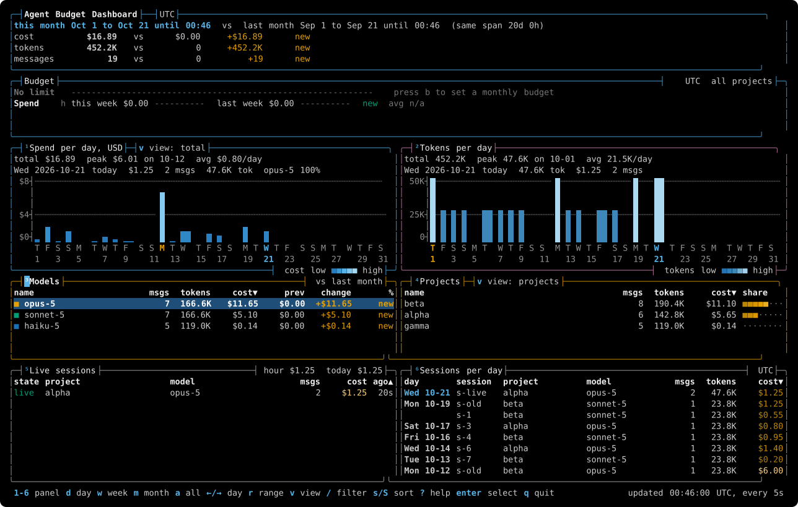

# Playbook

[](https://github.com/amplifiedengineer/playbook/actions/workflows/rust-ci.yml) [](https://scorecard.dev/viewer/?uri=github.com/amplifiedengineer/playbook) [](https://github.com/amplifiedengineer/playbook/releases) [](LICENSE)

Plan and ship with Claude Code, and see what it costs.



For developers who use Claude Code every day and want a repeatable workflow, safety guards and a clear view of their spend.

## Why

Out of the box, Claude Code leaves planning, review, safety rules and cost tracking to you. Playbook adds slash commands and skills for planning and review, plus a small Rust binary that runs the guards and a usage dashboard. The plugin works alone, and the binary is optional.

## What you get

| Feature | What it does | Learn more |
|---|---|---|
| Plan to PR | `/playbook:plan` makes a checked plan. `/playbook:implement` builds it one small PR at a time. | [Guide](docs/guides/01-plan-and-implement.md) |
| Code search | One tree-sitter index per repo, shared by every worktree. `playbook code` finds symbols and fits whole declarations into a token budget. | [Commands](docs/reference/cli-and-config.md#playbook-code) |
| Document reading | `playbook doc read` turns a PDF or Office file into text on your machine, with about 41% fewer tokens on text PDFs. | [Guide](docs/guides/06-reading-documents.md) |
| pbtop | A terminal dashboard of token use and cost by session and by model, with your usage limits. | [Guide](docs/guides/11-pbtop.md) |
| Review | `/playbook:review` sizes the diff, then runs a quick or a deep review. | [Guide](docs/guides/02-review-and-pr-flow.md) |
| Safety guards | The rm guard blocks `rm -rf /` and `rm -rf ~`. An opt-in guard denies a short list of risky calls. | [Guide](docs/guides/07-rm-guard.md) |

## Install

```bash
brew install amplifiedengineer/tap/playbook
```

Use the full name, which trusts only this formula. With no Homebrew, run the install script. It checks the release checksum, and its build attestation when `gh` can check it:

```bash
curl -fsSL https://raw.githubusercontent.com/amplifiedengineer/playbook/main/install.sh | bash
```

Pin a version with `PLAYBOOK_REF=v0.41.0`. Nix, Windows, the plugin on its own and every other route are in the [install guide](docs/guides/00-install.md). Coming from the old org or tap name? See [Moving from the old tap name](docs/guides/00-install.md#moving-from-the-old-tap-name).

## First use

```bash
playbook setup
```

Setup shows each change and asks first. [What setup installs](docs/guides/05-what-setup-installs.md) lists them all. Then, in a Claude Code session:

```text
/playbook:plan         turn an idea into a verified plan
/playbook:implement    build it with subagents and tests, one small PR at a time
/playbook:review       review the result
```

## Trust

- Every release asset has a SHA256SUMS entry and a GitHub build provenance attestation.
- CI runs the tests on every pull request, and OpenSSF Scorecard scores the repo.
- Apache License 2.0. To report a vulnerability, see [SECURITY.md](SECURITY.md).

## Docs

New here? Start with [Get started](docs/get-started.md). The [docs map](docs/README.md) links every page. Look things up in the [CLI and config reference](docs/reference/cli-and-config.md), the [hook reference](docs/reference/hooks.md) and [What setup installs](docs/guides/05-what-setup-installs.md).
