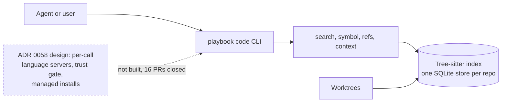
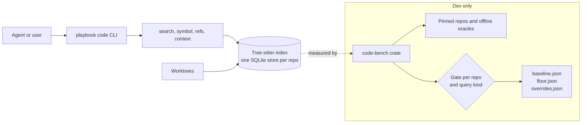

# ADR-0060: Answer Code Questions From the Tree-sitter Index Only, With a Precision and Recall Gate

- **Status:** Accepted
- **Date created:** 2026-11-06
- **Date modified:** 2026-11-06
- **Supersedes:** [ADR 0058](0058-answer-symbol-questions-with-language-servers.md) decisions 1 to 6. Decision 7 carries over unchanged (decision 5 below). Decision 4 below replaces ADR 0058's benchmark bars.
- **Amends:** [ADR 0026](0026-local-code-index-in-the-binary.md) decision 3 (managed language server downloads and trust). The rest of ADR 0026 stands.
- **Relates to:** [ADR 0056](0056-share-one-code-index-across-worktrees.md) (one shared index per repo)

## Context

`playbook code` indexes a repository with Tree-sitter and answers symbol and refs queries from a local SQLite index (ADR 0026, shared across worktrees by ADR 0056). ADR 0058 (Accepted) added language servers on top: one server process per CLI call, a workspace trust gate, managed installs of `rust-analyzer`, `typescript-language-server` and `pyright`, and new commands (`docs/adr/0058-answer-symbol-questions-with-language-servers.md:15-20`).

Most of that design did not reach main. The 16 `feat/code-lsp-*` pull requests (#1488 to #1512, `gh pr list`, 2026-11-06) are all closed, and so are the three benchmark pull requests #1521, #1528 and #1532 (closed drafts). Only ADR 0058 itself landed (#1432, merged). On main there is no language server code under `crates/` (`grep -rli lsp crates` finds only an unrelated telemetry file, a prompt-rules test and a spreadsheet fixture) and no `tar` entry in `Cargo.lock`. `flate2` is there only through other crates (`grep -c lsp Cargo.lock` returns 0). The record and the code disagree.

The benchmark evidence for the language server route has two sides. The figures come from the benchmark reports `lsp-arm.md`, `lsp-bench-rerun.md` and `lsp-verdict.md`, which are not committed to the repo. `plan:N` means line N of the approved evaluation plan, which is also not committed.

- The Tree-sitter index saved 90.0 percent of output bytes at 5,000 files and 90.4 percent at 50,000 files against the plan baseline, and 88.7 and 88.9 percent against `rg` plus file reads. Its top-3 and refs recall were 100 percent (`lsp-arm.md:20-21`; the realistic fixture rerun shows the same, `lsp-bench-rerun.md:17-18`). An earlier run on an unrealistic fixture showed negative savings; the rerun traced that to the fixture (`lsp-verdict.md:10-14`, `lsp-bench-rerun.md:27`).
- Language servers saved 99.8 and 99.7 percent on the 20 tasks they can answer (`lsp-arm.md:23,25`). Part of that gap is output format: a server returns 17 to 19 bytes per answer and the index returns about 700 bytes of JSON (`lsp-arm.md:32`). Servers answer 20 of the 32 tasks. The index answers all 32 (`lsp-arm.md:34`).
- Refs recall for servers was 53 percent at 5,000 files and 71 percent at 50,000 files. Same-language recall was 91 and 83 percent. The fixture has no imports, which caps cross-language recall for any server (`lsp-arm.md:23,25,33`). This number says little about servers on real code, and the same report asks for a fixture with imports (`lsp-arm.md:43`).
- Cold start was 2.7 s for `rust-analyzer` at 5,000 files on a quiet machine and 32 s on a loaded one. At 50,000 files `rust-analyzer` took 7.3 s and `pyright` 16.4 s, and `tsserver` was not ready in 900 s (`lsp-arm.md:23,25,36`). Warm `pyright` p50 at 50,000 files was 9.3 s (`lsp-arm.md:28`). Under ADR 0058 decision 1 every call pays cold start, because no server stays alive between calls (`lsp-arm.md:35`).

The approved evaluation plan then set the direction: no language servers at runtime, no automatic downloads, no Rust sidecar server or daemon (the plan also rules out an MCP server) (`plans/tree-sitter-code-index-evaluation.md:22`). The same plan finds that nothing today proves the index is accurate or cheaper than `rg` plus reads. The only benchmark is synthetic and lives on draft branches (`plan:8`). It also notes that 290 unit tests and 32 CLI tests exist and none measures retrieval quality (`plan:11`). ADR 0058's bars (90 percent, 25 percent, 5 seconds) were informational and cover only bytes and latency, with no accuracy metric (`docs/adr/0058-answer-symbol-questions-with-language-servers.md:49`, `plan:50`).

## Decision Drivers

1. Cut token cost and raise accuracy together. A saving that lowers accuracy fails (`plan:14`).
2. Answers stay deterministic, offline at query time and safe. Servers run workspace code (build scripts, proc macros, the project interpreter), which needs a trust gate (ADR 0058 decision 2).
3. Cost per call. A server per call pays cold start every time, seconds at 5,000 files and tens of seconds at 50,000 files.
4. Maintenance. Pinned hashes, archive extraction and three server stacks need a maintainer to refresh them (`docs/adr/0058-answer-symbol-questions-with-language-servers.md:62`).
5. The decision record must match main. Today it does not.
6. Judge the numbers per repo and query kind on a repeatable run. One synthetic fixture is too narrow.

## Considered Alternatives

### A. Keep ADR 0058 as accepted: language servers behind the trust gate (effort: XL)

Rebuild the 16 closed pull requests, fix the issues that closed them, and ship per-call servers, managed installs and the new commands. Trade-offs:

- Servers give exact declarations and resolved refs where code resolves.
- Every call pays cold start. The measured range runs from 2.7 s to 32 s at 5,000 files, with `tsserver` not ready in 900 s at 50,000 files.
- Users must opt in twice (install a server, trust the repository). Maintainers carry pinned hashes and an archive extractor.
- Nothing proves the index is accurate, so there is no baseline to say whether servers add anything.

### B. Hybrid: use installed servers, fall back to Tree-sitter, optional Rust sidecar servers (effort: XL)

Use a language server only when the user already has one installed. Fall back to Tree-sitter otherwise. Optionally ship a sidecar server written in Rust for faster starts. Trade-offs:

- Drops managed downloads and the extractor, and keeps the trust gate and the process lifecycle.
- Answers differ by machine, because they depend on which servers and versions are installed. That breaks the repeatable-metrics driver.
- A sidecar server is a new product to build and maintain, in addition to the index.
- The cold-start and workspace-code risks stay for every installed server.

### C. Tree-sitter only, with a precision and recall gate (effort: L, chosen)

The code module answers from the index. Remove the language server design from the record. Build the benchmark and gate described in the plan, and fix index defects with the gate as the judge. Trade-offs:

- No type-aware answers. `refs` stays spelling based until the plan's scope and import fix (WU-22) lands.
- No process lifecycle, no trust gate and no downloads to maintain.
- The work is a dev-only benchmark crate and index fixes. The plan splits it into 11 segments of about 450 lines each (`plan:88-100`).

## Decision

Choose C. The owner approved this direction (no language servers, no automatic downloads, no sidecar server) in the evaluation plan, so the status is Accepted.

1. **The code module answers from the Tree-sitter index only.** `playbook code` search and symbol, plus the other index commands, read the local index and nothing else.
2. **We drop language servers as a runtime feature.** This reverses ADR 0058 decisions 1 to 6 (`plan:50`): per-call server processes (1), the workspace trust gate (2), server fallback reasons (3), managed installs (4), own tar extraction with the `flate2` and `tar` dependencies (5), and the `definition`, `hover` and `diagnostics` commands, the position form of `code refs`, `code lsp list|status|install|remove`, and the `code.lsp.*` and `code.python.interpreter` keys (6). We add no Rust sidecar server and no daemon. Servers may still serve as offline oracles inside the dev-only benchmark crate. They do not run at runtime (`plan:111`).
3. **Nothing downloads automatically.** ADR 0026 decision 3 (managed server downloads, hashes in source, workspace trust) is withdrawn. No `playbook code` command touches the network.
4. **A gate on accuracy and bytes per correct result replaces ADR 0058's bars.** We retire the 90 percent, 25 percent and 5 second bars. The gate runs on each repo and query kind pair. An average would hide a drop in one repo. A change fails when precision or recall drops below the committed baseline, or when bytes per correct result rise beyond a 0.5 percent tolerance, unless precision or recall rises and the rise stays within a per-point budget (`plan:34`). A committed `baseline.json` and `floor.json` hold the accepted values. Recorded overrides in `overrides.json` need an id, a reason and an expiry date. A gate test fails when either data file is lower than its merge-base copy and no override matches. An override names the repo, query kind and exact delta, and the gate fails when the observed drop is larger. A repo and query kind pair with fewer than 10 tasks is unmeasured and fails unless the baseline lists it. The per-PR fixture gate uses a 3-task minimum on committed fixtures only, and the 10-task rule applies to the real-repo gate. A cumulative drift check compares results with `floor.json`, net of unexpired override deltas. The merge-base check runs in CI with full history and fails, never skips, when the merge base is missing. The per-PR gate runs on committed fixtures. The real-repo benchmark runs nightly, so a regression on a real repo shows up after merge. The gate test cannot stop a pull request that lowers a data file and adds a matching override in the same change, so owner review of these files is part of the control. Code owner review is not required by the ruleset today, and turning it on is a settings change for the owner (`plan:48`). Latency stays informational.
5. **The crate boundary carries over unchanged.** `playbook-code` cannot depend on the cli crate. The cli builds the settings and the HTTP fetcher and passes them in `Env` (ADR 0058 decision 7, `docs/adr/0058-answer-symbol-questions-with-language-servers.md:23`).
6. **The closed pull requests stay closed.** #1488 to #1512, #1521, #1528 and #1532 are already closed. No work unit removes code, because the code is not on main (`plan:50`).

ADR 0058 gets a one-line marker and an updated Status line (see Edit to ADR 0058 below).

### Why the other alternatives lose

- **A** has the highest cost and the weakest proof. It pays cold start on every call and adds a trust step for every user. It also pays for three server stacks and an extractor. Its own benchmark shows `tsserver` not ready in 900 s at 50,000 files and `pyright` at a 9.3 s warm p50 (`lsp-arm.md:25,28`). The index already saves about 90 percent of output with 100 percent recall on the same tasks. The extra bytes saved by servers come partly from output format (`lsp-arm.md:32`).
- **B** removes the download risk and keeps the others. Results change with each machine's installed servers and versions, so the gate cannot repeat its numbers. The sidecar option adds a new server to build for a gain no one has measured. B can return later as a new ADR if the gate shows a query kind where Tree-sitter cannot reach the floor.

## Consequences

- The record matches main. ADR 0058 reads Superseded, and its closed pull requests no longer contradict it.
- The module no longer offers type-aware answers (resolved definitions, hover, diagnostics). Agents use the index, `rg` and file reads for those questions.
- Refs keep matching by spelling until the scope and import fix passes the gate. Precision is the metric that will show the gain.
- The gate makes every index change visible per repo and query kind. A fix that helps one repo and hurts another fails.
- The benchmark crate, pinned corpus and oracles are new maintenance. They are dev-only and stay out of the shipped binary (`plan:54`).
- The evidence for servers is thin for real code: the fixture had no imports, so refs recall for servers is not a fair measurement. If a later gate run shows an index floor that users cannot accept for a query kind, a new ADR can bring back an optional server for that kind.
- The measured savings (about 90 percent against the plan baseline) come from a synthetic fixture. The gate replaces that number with results on pinned real repositories.
- ADR 0026 decision 3 and ADR 0058 decisions 1 to 6 stop being current. Docs that mention `code lsp` commands do not exist on main.

## Architecture Diagrams

### Current state (what main does)



### Proposed state



## Edit to ADR 0026

The Status line gains "and by ADR 0060 (decision 3 withdrawn)", a one-line withdrawn marker goes under the decision 3 heading, and the modified date moves to 2026-11-06.

## Edit to ADR 0058

The working tree already holds this edit. It touches only the Status line, the modified date and one new line under the title.

```diff
 # ADR-0058: Answer Symbol Questions With Language Servers, One Per Call, Behind a Trust Gate
 
-- **Status:** Accepted
+> Superseded by [ADR 0060](0060-use-tree-sitter-only-for-the-code-index.md). Decision 7 (the crate boundary) carries over to it.
+
+- **Status:** Superseded by [ADR 0060](0060-use-tree-sitter-only-for-the-code-index.md) (decisions 1 to 6; decision 7 carries over)
 - **Date created:** 2026-10-21
-- **Date modified:** 2026-11-04
+- **Date modified:** 2026-11-06
```
