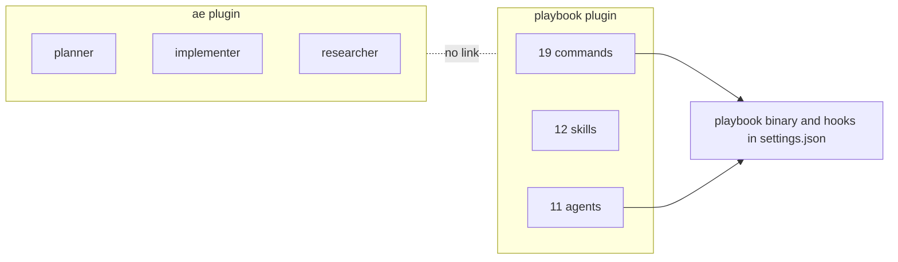
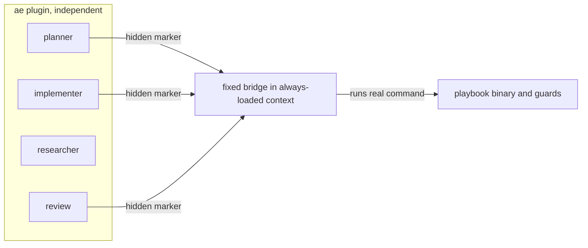
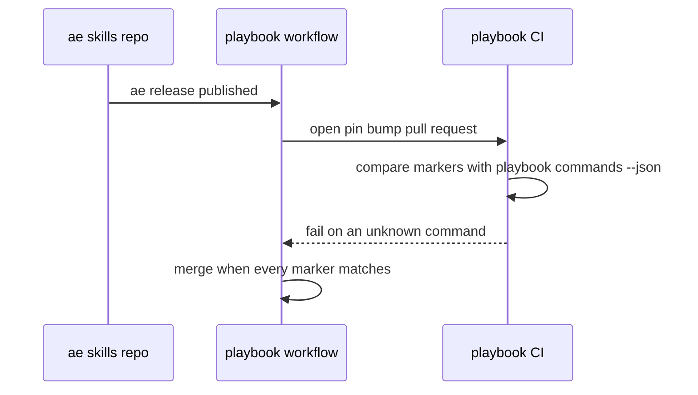

# ADR-0062: Playbook Bridges the Independent ae Skills With Hidden Markers

- **Status:** Accepted
- **Date created:** 2026-11-20
- **Date modified:** 2026-11-20
- **Amends:** decision 1 of [ADR 0032](0032-plugin-in-the-playbook-repo.md) and decisions 1 and 4 of [ADR 0038](0038-one-release-line.md), when the playbook plugin retires. Decision 12 of this record sets the direction. A plan sets the order.

## Context

Two products exist. The `ae` plugin in `AmplifiedEngineer/skills` holds three skills: `planner`, `implementer` and `researcher` (`plugin.json` name `ae`, version 0.1.0). None of them mention playbook. The playbook plugin in `plugins/playbook` holds 12 skills, 19 commands and 11 agents. Its commands overlap the `ae` skills: `plan`, `implement`, `review`, `audit`, `fix`.

The owner's direction since 2026-11-12 is that the plain skills are the main product and the `playbook` binary is optional. Installing the binary should make the skills faster and safer. The skills must keep working alone, in Claude Code and in Codex.

ADR 0030 split the plugin into a second repository, ADR 0032 moved it back into this one, and ADR 0038 gave the plugin and the binary one release line. The playbook plugin therefore ships its own workflow commands from this repository. That layout gives two competing sets of workflow text. An agent that has both installed has no rule for which one to follow.

Three constraints come from the code today:

1. Guards are binary hooks in `settings.json` (`seed/settings.shared.json`, for example `playbook hook rm-workspace-guard` and `policy-guard`). The worktree hooks sit there too: `WorktreeCreate` runs `playbook hook worktree-create` and `WorktreeRemove` runs `playbook hook worktree-remove` (golden file `crates/cli/tests/fixtures/golden/init.clean-install.json`). ADR 0031 moved them out of the plugin. The memory fact `marketplace-moves-to-skills-repo` still says the plugin ships `hooks/hooks.json`. That is out of date: `plugins/playbook` has no `hooks` folder.
2. A session may leave a skill body unloaded. A rule that must apply in every session cannot live only in a skill. `seed/prompts/SYSTEM_PROMPT.md` (1,601 words) and the SessionStart hook context load in every session.
3. ADR 0032 decision 6 already checks the plugin prose against the binary: `playbook commands --json` lists every command and who may run it, and a check fails when the prose names a command that is missing. The SessionStart tool map and `intents.json` already map tasks to commands without markers. ADR 0031 sets the rules for any text that `playbook init` writes into user config: `init` asks first (decision 2), owns only entries it can recognize (decision 3), `uninstall` removes only those (decision 4) and `doctor` checks them (decision 5).

A spike on 2026-11-20 tested whether hidden HTML comments reach the model. `claude -p` and `codex exec` each loaded a project skill with `<!-- playbook: spike-token-4417 -->` between two steps. Both quoted the comment back verbatim. Neither agent strips it.

## Decision Drivers

- The `ae` skills must work alone and keep playbook out of their visible text.
- One owner controls both repositories, so version drift is a release problem that automation can check.
- A user who installs playbook should get faster, safer steps without a second set of workflow text.
- An agent needs one rule it sees in every session, not a skill that may stay unloaded.
- The design must work in Claude Code and in Codex, which share the skill format.
- A command rename must fail CI, not silently break a skill.

## Considered Alternatives

### Keep two sets of workflow text, the status quo (effort: S)

- The playbook plugin keeps its own `plan`, `implement` and `review` commands. The `ae` skills stay separate.
- Trade-offs: no work now. The two sets drift, and an agent with both installed picks one at random. Playbook cannot make the `ae` skills faster, because it does not touch them.

### Vendor the `ae` skills into playbook and patch them (effort: L)

- Playbook copies the skills and adds playbook steps with an overlay and a sync script.
- Trade-offs: playbook controls the text. The copy drifts from the `ae` source, the sync script needs upkeep, and a user sees two skills with the same name. The 2026-11-14 skills plan already rejected this ("move, not copy": no vendoring and no sync script).

### A `playbook do <step>` dispatcher command (effort: M)

- Skills call one playbook command that routes to the real command.
- Trade-offs: one entry point. It adds a second name for every command. The owner rejected it on 2026-11-18: playbook already has the commands, so a command that calls the commands adds a layer and no function. A rename still needs two edits.

### A playbook MCP server (effort: L)

- Playbook exposes its work as MCP tools, and skills call the tools.
- Trade-offs: it works in an agent with no shell. Both target agents have a shell, and the binary already runs from the command line. An MCP server adds a long-running process, a schema to keep, and a second way to do the same work.

### Extend the tool map and `intents.json` to the `ae` skills (effort: M)

- The SessionStart tool map names playbook commands by task. Playbook adds one entry for each `ae` skill step it can run faster, and the agent matches the entry to the step by wording.
- Trade-offs: no edit to the `ae` skills. The map matches on prose wording, so a reworded step breaks the match with no failing check. A marker sits on the exact step it replaces.

### Hidden markers plus a fixed bridge (effort: M)

- Chosen. See Decision.

## Decision

Playbook stays a binary. It bridges the independent `ae` skills with hidden markers and one fixed rule that loads in every session.

1. **The `ae` skills stay independent.** Their visible text does not mention playbook. They work with no binary installed.
2. **Markers carry the link.** A skill step that playbook can run faster has a hidden HTML comment on the next line: `<!-- playbook: pr create -->`. The words after `playbook:` are a real playbook command. The spike confirms that Claude Code and Codex pass the comment to the model unchanged.
3. **One fixed bridge loads in every session.** Installing playbook writes the same short rule into the context that loads in every session. Claude Code gets it through the SessionStart hook context, which `playbook hook session-init` already prints. Codex gets it from a marked block in the global `AGENTS.md`. The system prompt does not carry it. The rule says: when a step carries a playbook marker and `playbook` is on the PATH, run that playbook command instead of the plain steps. If the installed binary has no such command, do the plain steps. The agent runs only commands that `playbook commands --json` lists, and skips any command whose `access` is `user-only`. The bridge does not change when the skills change.
4. **The bridge follows ADR 0031.** `init` asks before it writes the bridge. The block carries an owner mark, so a merge keeps the user's own text. `uninstall` removes only the marked block, and `doctor` reports whether it is present.
5. **There is no dispatcher.** The marker names the real command words, with no flags. The agent reads the flags from the command's own `--help`. A rename is one edit in the skill and one in the binary, and CI checks the match.
6. **A step that needs several commands gets a real workflow command**, for example `playbook deliver`, and the marker names that command.
7. **Every marked step keeps complete plain text.** A skill with a marker works the same with no binary. The marker only offers a faster path.
8. **Playbook pins one `ae` version.** There is no runtime version check. The fallback in decision 3 covers a marker that names an unknown command. If a user mixes versions in any other way, that user fixes it, and the documentation says so.
9. **Automation keeps the two in sync.** An `ae` release starts a playbook workflow. The workflow fails CI when a marker in the pinned skills names a command that `playbook commands --json` does not list. The check runs against the binary built from the same commit as the pin. A user with an older binary falls back to the plain steps through decision 3. A pull request then bumps the pin. This extends the check from ADR 0032 decision 6.
10. **Review becomes a fourth `ae` skill** (owner decision, 2026-11-20). The `ae` plugin then covers four jobs: planning, research, implementation and review.
11. **Guards stay in playbook only** (owner decision, 2026-11-20). They are binary hooks in `settings.json`. The worktree hooks already follow the same path, so they need no move.
12. **ADR 0032 and ADR 0038 change in part.** The plugin stops growing its own workflow commands. It retires when its commands have `ae` skills and markers. The tool map and `intents.json` keep serving the playbook plugin until it retires, and they retire with it. Decisions 10 to 12 are direction. Each gets its own plan, and the retirement order goes into the plan, not this record.

The alternatives lose for these reasons. Extending the tool map matches on prose wording and has no check for a reworded step. The status quo leaves two sets of workflow text and no rule between them. Vendoring copies the text and needs a sync script, which the owner already rejected. The dispatcher adds a command that only calls commands. The MCP server adds a process and a schema for agents that already have a shell.

## Consequences

- The `ae` skills stay useful alone. Installing playbook adds speed and safety without a second skill set.
- Each `ae` release costs a pin bump in the playbook repository. CI turns a marker drift into a failing job.
- Each `ae` skill step that gains a marker needs a matching playbook command, so the binary's command list becomes part of the skills' contract.
- A user who runs a newer `ae` than the pin can hit a marker that names an unknown command, and the fallback takes the plain steps. A command with the same name and changed flags is the user's responsibility, and the agent reads the flags from `--help`. The documentation says so.
- A new agent that strips comments breaks the bridge. Re-run the spike before supporting one.
- The spike shows that both agents quote a marker back. It does not show that they obey the bridge rule, and it used a project skill with a non-interactive run. Before the first marker ships, run an obey test with an installed plugin in both agents: the agent runs the marked command, then falls back to the plain steps when the command is missing.
- Plan work: `init` writes the Codex `AGENTS.md` block, and `uninstall` and `doctor` handle it. This is new code, because ADR 0031 covers only `settings.json` entries.
- A comment is an instruction channel. The bridge limits it to commands the binary lists, minus the `user-only` ones.
- The playbook plugin loses its workflow commands over time. Users get one migration for the marketplace change, tracked in the marketplace move plan.

### Open question: the 11 agents

The owner has not decided where the 11 agents go: `analyst`, `auditor`, `cheap-checker`, `collector`, `critic`, `fact-checker`, `implementer`, `review-triage`, `reviewer`, `test-reviewer` and `writer`. `reviewer` appears 8 times and `implementer` 6 times in the plugin commands and skills. Two options remain: ship them inside the `ae` plugin, or keep them in playbook. The marketplace move and the retirement of the playbook plugin wait for this decision. `/playbook:plan` interviews the owner on it before any agent moves.

## Architecture Diagrams

Current state:

Proposed state:

Release and sync flow:

