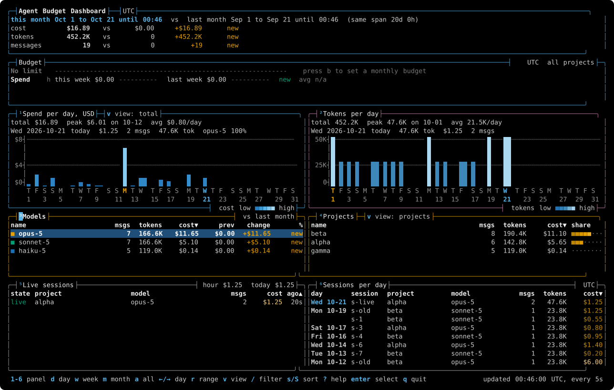

# pbtop, the Agent Budget Dashboard on its own

The full pbtop page, with a picture of every view, the keys, the data sources and the cost and limit math, is now [pbtop](../pbtop.md).

`pbtop` is the dashboard as one small program, for a machine without playbook. With playbook installed you do not need it: `playbook usage` runs the same code. The [install guide](00-install.md#optional-pbtop-alone) shows how to install it alone.

The code index has no standalone tool. It ships inside `playbook` as `playbook code`.
